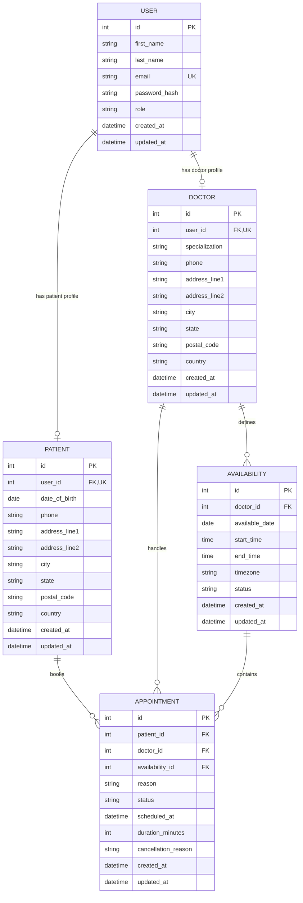

# Schedula Entity-Relationship Diagram

This production-oriented conceptual ERD models the core hospital appointment scheduling workflow.

## Relationship Explanation

- **User -> Patient: one-to-one** - A user can have zero or one patient profile, and each patient profile belongs to one user.
- **User -> Doctor: one-to-one** - A user can have zero or one doctor profile, and each doctor profile belongs to one user.
- **Doctor -> Availability: one-to-many** - A doctor can define many availability windows, and each availability window belongs to one doctor.
- **Patient -> Appointment: one-to-many** - A patient can have many appointments, and each appointment belongs to one patient.
- **Doctor -> Appointment: one-to-many** - A doctor can handle many appointments, and each appointment belongs to one doctor.
- **Availability -> Appointment: one-to-many** - An availability window can contain many appointments, and each appointment belongs to one availability window.

The current schema has no many-to-many relationships. A many-to-many relationship would require a dedicated join table. For example, shared availability would require a `DoctorAvailability` table between `Doctor` and `Availability`; the current model is doctor-specific because `Availability.doctor_id` assigns each availability window to one doctor.

## Schema and Business Rules

- `User.email` must be unique and normalized for future authentication.
- `password_hash` is reserved for secure future authentication storage; plaintext passwords must never be stored.
- `Patient.user_id` and `Doctor.user_id` must be unique to enforce one profile per user role.
- The unique `user_id` foreign keys enforce the one-to-one User-to-profile relationships.
- `Availability.doctor_id` allows one doctor to have many availability records while each record belongs to one doctor.
- `Appointment.patient_id` and `Appointment.doctor_id` allow patients and doctors to have many appointments.
- `Appointment.availability_id` is non-unique so multiple appointments can share one broad availability window.
- `User.first_name` and `User.last_name` provide separately searchable identity fields.
- `date_of_birth` is used instead of `age` because age changes over time.
- `Availability.end_time` must be later than `Availability.start_time`.
- A doctor's availability windows must not overlap.
- `Availability.timezone` preserves the local timezone for the availability window.
- A confirmed appointment must reference an available availability window.
- `Appointment.doctor_id` must be derived from `Availability.doctor_id` when an appointment is created.
- The appointment doctor and availability doctor must always match.
- `Availability` is a broad working window and may contain multiple appointments.
- `Appointment.availability_id` must not be unique.
- Each appointment must have its own `scheduled_at` and `duration_minutes`.
- Appointment times must fit inside the referenced availability window.
- Appointments for the same doctor must not overlap.
- Appointment statuses should support at least `requested`, `confirmed`, `completed`, `cancelled`, and `no-show`.
- Availability statuses should support at least `available`, `held`, `booked`, `blocked`, and `cancelled`.
- Timestamps should be stored consistently and appointment scheduling should use timezone-aware values in the PostgreSQL implementation.
- Authentication lifecycle fields such as account activation, email verification, and last-login tracking are deferred until authentication requirements are defined.
- Doctor licensing and verification fields are deferred until licensing requirements are defined.

## Scope Decisions

This ERD keeps the required five core entities. Separate `Address`, `Credential`, `Location`, `AuditLog`, `Notification`, `AppointmentHistory`, licensing, and authentication entities may be introduced during detailed backend design if the application requires them.

Medical records, diagnoses, prescriptions, payments, insurance, and other clinical or financial modules are outside the scope of this scheduling ERD.

## References

- [OWASP Password Storage Cheat Sheet](https://cheatsheetseries.owasp.org/cheatsheets/Password_Storage_Cheat_Sheet.html)
- [HL7 FHIR Patient](https://hl7.org/fhir/R4B/patient.html)
- [HL7 FHIR Practitioner](https://hl7.org/fhir/R4B/practitioner.html)
- [HL7 FHIR Appointment](https://hl7.org/fhir/R4B/appointment.html)
- [HL7 FHIR Slot](https://hl7.org/fhir/R4B/slot.html)
- [PostgreSQL Date/Time Types](https://www.postgresql.org/docs/current/datatype-datetime.html)
