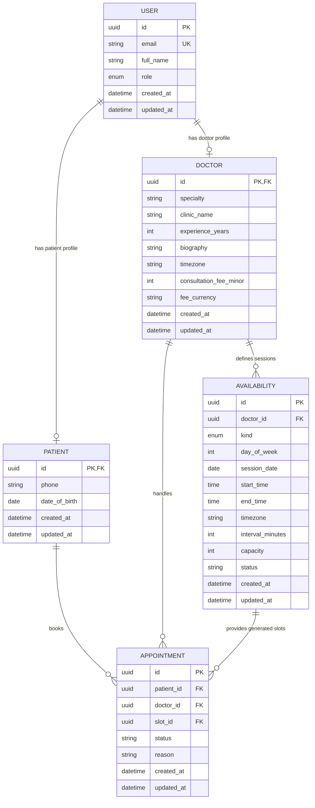

# Schedula Entity-Relationship Diagram

This conceptual ERD is synchronized with the implemented Supabase and Drizzle model. It keeps the five required domain modules in order while documenting implementation-specific tables separately.

## Relationship and implementation notes

- `USER` represents the application profile joined to Supabase `auth.users`. The email is owned by Supabase Auth; `full_name` and `role` are stored in `profiles`.
- `PATIENT.id` and `DOCTOR.id` are both the profile ID and enforce one profile per user role. There are no separate `user_id` columns in the implemented schema.
- Patient onboarding currently stores phone and date of birth.
- Doctor onboarding and editing store specialty, clinic name, experience, biography, and IANA timezone.
- `AVAILABILITY` represents an `availability_sessions` record. A `weekly` record stores an ISO consulting weekday and continues every week; a `custom` record stores one local calendar date and overrides recurring availability for that date. The application generates date-specific `appointment_slots` from both kinds of session; slots are intentionally kept outside this five-module conceptual ERD.
- `APPOINTMENT` references a generated slot through `slot_id`, while doctor and patient ownership are retained for authorization and reporting.
- `notifications`, payment, refund, reservation, and reminder tables support the appointment lifecycle but remain implementation-specific support tables, not additional conceptual domain modules. See [`day-4-payments-operations.md`](day-4-payments-operations.md) for the payment and notification operational design.

## Business rules

- Profile roles are limited to `patient` and `doctor` and are immutable after profile creation.
- Patient and doctor profile IDs must reference the same authenticated user profile.
- A doctor’s weekly sessions must not overlap on the same consulting day; custom sessions must not overlap on the same date and override recurring hours for that date.
- Availability must start in the future, end after it starts, and use a supported interval and capacity.
- Appointments must reference a valid generated slot and matching doctor.
- A patient cannot book the same slot twice.
- Appointment lifecycle includes payment-pending, confirmed, cancelled, and expired states; payment and refund records retain the financial state separately from appointment cancellation.
- All audit timestamps use timezone-aware database timestamps.
- Passwords are managed by Supabase Auth and are never stored in the application schema.

## Scope decisions

This diagram intentionally keeps payments, refunds, reservations, and notification delivery outside the five required conceptual modules. They are implemented as supporting tables for the appointment lifecycle rather than as new healthcare domain entities.

## References

- [OWASP Password Storage Cheat Sheet](https://cheatsheetseries.owasp.org/cheatsheets/Password_Storage_Cheat_Sheet.html)
- [HL7 FHIR Patient](https://hl7.org/fhir/R4B/patient.html)
- [HL7 FHIR Practitioner](https://hl7.org/fhir/R4B/practitioner.html)
- [HL7 FHIR Appointment](https://hl7.org/fhir/R4B/appointment.html)
- [HL7 FHIR Slot](https://hl7.org/fhir/R4B/slot.html)
- [PostgreSQL Date/Time Types](https://www.postgresql.org/docs/current/datatype-datetime.html)
